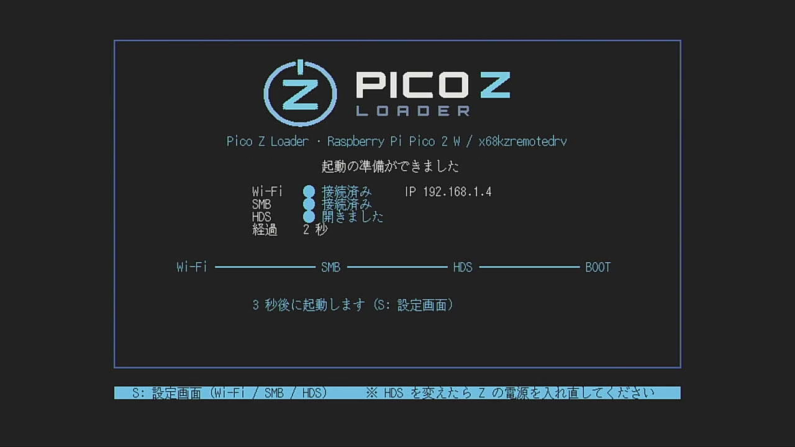
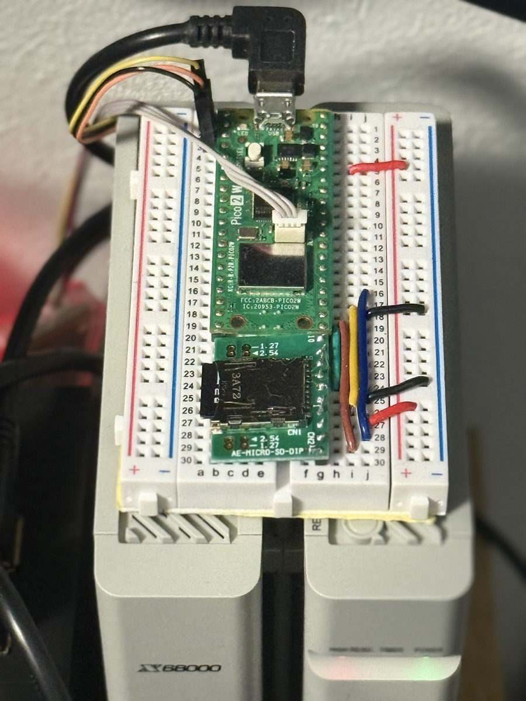
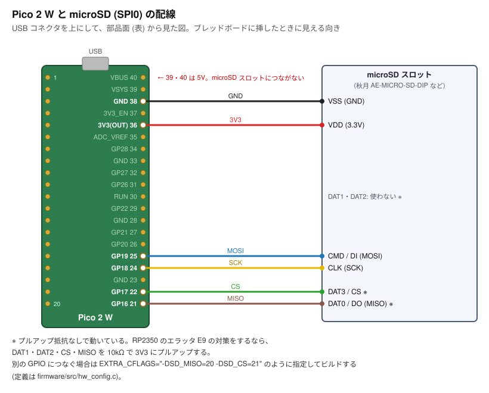

# Pico Z Loader



X68000 Z の USB に挿した Raspberry Pi Pico 2 W (と microSD カード) を、ディスク・ネットワーク・キーボードとして使うためのファームと、Human68k のドライバやプログラムをまとめたリポジトリです。

ファームは yunkya2 さんの [x68kzremotedrv](https://github.com/yunkya2/x68kzremotedrv) を元にしています。x68kzremotedrv の作者や配布元に、このリポジトリについて問い合わせないでください。不具合は、このリポジトリの Issue で報告してください。

## 謝辞

- **yunkya2 さん**: [x68kzremotedrv](https://github.com/yunkya2/x68kzremotedrv) (Pico W を Z の USB ディスクとして動かし、Windows の共有フォルダに置いた HDS (ハードディスクのイメージファイル) とリモートドライブを使えるようにするファーム)、[x68kserremote](https://github.com/yunkya2/x68kserremote)、[elf2x68k](https://github.com/yunkya2/elf2x68k) (Human68k 向けの gcc)。このリポジトリのファームは x68kzremotedrv の履歴をそのまま引き継ぎ、その上に変更を積んでいます。x68kzremotedrv がなければ、このリポジトリはありませんでした。
- [libsmb2](https://github.com/sahlberg/libsmb2) (Ronnie Sahlberg さんほか)
- [FatFs](http://elm-chan.org/fsw/ff/) (ChaN さん) と [no-OS-FatFS-SD-SDIO-SPI-RPi-Pico](https://github.com/carlk3/no-OS-FatFS-SD-SDIO-SPI-RPi-Pico) (Carl J Kugler III さん)
- [dropbear](https://matt.ucc.asn.au/dropbear/dropbear.html) (Matt Johnston さんほか)、[Monocypher](https://monocypher.org/) (Loup Vaillant さんほか)
- Raspberry Pi Pico SDK、TinyUSB、lwIP、FreeRTOS
- [Twemoji](https://github.com/jdecked/twemoji) (端末の絵文字、CC-BY 4.0)
- 試験には [XEiJ](https://stdkmd.net/xeij/) (Makoto Kamada さん) を使っています (このリポジトリには含みません)

## できること

### Pico 2 W のファーム (`firmware/`)

| 機能 | 中身 |
|---|---|
| ディスク | 共有フォルダ (SMB) の HDS とリモートドライブ (x68kzremotedrv の機能) |
| SD カード | microSD の HDS から起動する。SD カードを C: ドライブとして使う |
| 起動画面 | 電源を入れると Z に出る画面 (このページの一番上の画像)。HDS を開けるまで Z の起動を待たせ、Wi-Fi の接続、SMB (共有フォルダ) の接続、HDS の状態を表示する。起動の準備ができても 5 秒は表示を続け、その間に [S] キーを押すと設定画面を開ける |
| TCP/IP | Z の `tis.x -p` からの TCP / UDP / DNS の要求を、Pico の lwIP で処理する。`.local` の名前解決には mDNS を使う |
| 暗号の計算 | ssh の鍵交換と署名 (X25519 / Ed25519) を、Z の代わりに Pico で計算する |
| USB キーボード | Pico を USB キーボードとしても認識させ、Wi-Fi 経由 (UDP ポート 6869) で Z にキー入力を送れる |
| ネットワークの設定 | Pico ごとのホスト名、固定 IP |

Z と Pico の間では、SCSI ID 6 のディスクの決まった LBA (ブロック番号) の範囲を読み書きして、データをやり取りします。

### Human68k のプログラム

| 場所 | 中身 |
|---|---|
| `net/tistack` | `tis.x`: 常駐型の TCP/IP スタック。xip.x と同じ `_TI_*` の API を持ち、`-p` オプションで処理を Pico に任せる |
| `net/npd` | `npd.sys` / `npd.x`: SCSI ID 6 で Pico とやり取りするドライバ |
| `net/ssh` | `ssh.x`: dropbear を移植した ssh クライアント。X25519 と ChaCha20-Poly1305 を 68000 向けに速くした |
| `net/accel` | 暗号の計算を Pico に頼む部分 (Z の側と Pico の側で同じソースを使う) |
| `term/vt100` | ssh.x の端末 (VT100、UTF-8 の日本語と絵文字) |
| `term/zterm` | 接続先で動く補助プログラム (Rust) と組んで画面を送る端末。ローカルエコー付き |
| `utils/` | `crtmode.x` (画面モードの切り替え)、`modetest.x`、XDF の読み書き (`xdf`)、`x68key` (Mac や Raspberry Pi から Z にキーを打つ道具、`picokbd`) |

## SD カードから起動する





Pico 2 W に microSD スロットを SPI でつなぐと、カードに置いた HDS から Z を起動できます。カードの HDS は Wi-Fi の接続を待たずに開くので、共有フォルダの HDS より早く起動します。

| Pico 2 W | microSD |
|---|---|
| GP16 (21 番ピン) | DAT0 / DO (MISO) |
| GP17 (22 番ピン) | DAT3 / CS |
| GP18 (24 番ピン) | CLK (SCK) |
| GP19 (25 番ピン) | CMD / DI (MOSI) |
| 3V3(OUT) (36 番ピン) | VDD |
| GND (38 番ピン) | VSS |

- 写真の基板は、プルアップ抵抗なしで動いています。RP2350 のエラッタ E9 (入力に設定したピンの接続先が高インピーダンスのとき、ピンの電圧が中間電位にとどまることがある不具合) の対策をするなら、DAT1・DAT2・CS・MISO を 10kΩ で 3V3 にプルアップしてください。
- 39・40 番ピン (VSYS・VBUS) は 5V です。microSD スロットにはつながないでください。
- 写真の基板は秋月電子の AE-MICRO-SD-DIP です。SPI のクロックは 25MHz です。

設定画面の HDS の欄、または Pico を PC に USB でつないだときに見える `config.txt` の HDS の項目に、`sd:` で始まる SD カード上のパスを書きます。

```
HDS0: sd:/x68000z/boot.hds
REMOTE_UNIT: 2
REMOTE1: sd:/
```

リモートドライブの欄に `sd:/` と書くと、SD カードを Z のドライブとして使えます。上の例では、`REMOTE0` に設定した共有フォルダが B:、`REMOTE1` に設定した SD カードが C: になります。

## 作り方

### ファーム

要るもの: cmake、arm-none-eabi-gcc (arm-gnu-toolchain 14.3 で確認)、m68k-xelf-gcc (elf2x68k、Z の画面に出すプログラムを作る)、python3。

```sh
git clone https://github.com/j3tm0t0/picoZloader
cd picoZloader
firmware/build-pico2w.sh ~/pzl-work      # pico-sdk 2.1.1 と FreeRTOS-Kernel を ~/pzl-work に取ってくる
# できたもの: firmware/build/x68kzremotedrv.uf2
```

SD カードをつなぐ SPI0 の既定のピン割り当ては、GP16: MISO / GP17: CS / GP18: SCK / GP19: MOSI です。ピン割り当てが異なる基板では、`EXTRA_CFLAGS="-DSD_MISO=20 -DSD_CS=21"` のように指定します。書き込みは、BOOTSEL ボタンを押しながら Pico を Mac や PC に挿して、uf2 をコピーします。

### Human68k のプログラム

elf2x68k の `m68k-xelf-gcc` を使います。

```sh
make -C net/tistack            # tis.x
make -C net/npd                # npd.sys / npd.x
cd net/ssh/dropbear && ./fetch.sh && ZTERM=1 FAST=1 ACCEL=1 ./build.sh   # ssh.x
```

## 元にしたもの

- ファーム: yunkya2/x68kzremotedrv の 3afd408 に、j3tm0t0/x68k の `net/x68kzremotedrv-netpipe/patches` の 0001〜0054 を積んだもの。履歴は `git log firmware/` で見られます。x68kzremotedrv のその後の変更 (2026-11-01 のリモートドライブの応答に関する変更など) は、まだ取り込んでいません。
- Human68k のプログラム: j3tm0t0/x68k の 22a1223 から写したもの。今後はこのリポジトリで直します。

## ライセンス

このリポジトリの独自のコードは MIT ([LICENSE](LICENSE))。`firmware/` は x68kzremotedrv (MIT、[firmware/LICENSE](firmware/LICENSE)) を元にしています。ファームと ssh.x に入る他者のソフトウェアとライセンスは [LICENSES/THIRD_PARTY.md](LICENSES/THIRD_PARTY.md) にまとめています。ファームには libsmb2 (LGPL-2.1) が入ります。
